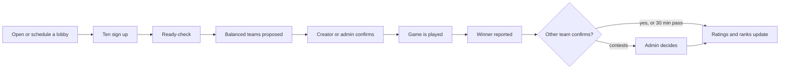

# Keep-Dreaming-Bot

A Discord bot for a private group of friends. It started as a "name of the day" joke and is now a
**League of Legends in-house league manager**: sign-ups and scheduled lobbies, ready-checks, balanced
teams that respect everyone's roles, result reporting, and a hidden rating with a visible in-house
rank that moves as games are played.


> The bot talks to players in Portuguese. This README and the documentation are in English.

## Contents

- [Features](#features)
- [How it works](#how-it-works)
- [Commands](#commands)
- [Getting started](#getting-started)
- [Configuration](#configuration)
- [Development](#development)
- [Documentation](#documentation)
- [Roadmap](#roadmap)
- [Riot Games disclaimer](#riot-games-disclaimer)

## Features

- **In-house lobbies.** One live message with buttons; ten players start a ready-check, silent
  players are replaced from the reserves. Lobbies can be opened now or scheduled for later, with a
  reminder before the start. State survives restarts.
- **Balanced teams without role picking.** Players never choose a role per game. Each is placed from
  their profile (best role, or next best when roles collide), and similar-strength players meet in the
  same lane.
- **Results and corrections.** A player reports the winner, someone on the other team confirms (or
  it confirms itself after 30 minutes). Admins can void or fix any game, with an audit trail.
- **Ratings and ranks.** Each player has a hidden in-house rating seeded from their League rank and
  changed only by confirmed results. The visible in-house rank (Bot Máximo to KD esports) appears
  after five games.
- **Champion and KDA per game.** Players enter their own stats, an admin validates them; champion
  and role icons show up in lobbies, matches, profiles and Riot history.
- **Optional Riot integration.** Link a League account to seed the rating from the Solo/Duo rank, and
  to estimate role experience and show recent ranked games.
- **Test without ten friends.** Mock players and a simulator let you try lobbies, results and ranks
  alone, and tune the matchmaking offline.
- **Name of the day.** `/puta` and `/putaindor`, the original feature, still run.

## How it works



Three ideas to keep in mind:

1. **Your League rank is the starting point, results take over.** A player's starting strength comes
   from their Riot rank (or one an admin or they set). In-house results then move a separate hidden
   rating, while the starting rank keeps matchmaking from drifting too far from reality.
2. **The in-house rank is its own thing.** It is derived from the hidden rating, hidden until a
   player has finished five placement games, and is not a League rank.
3. **Only confirmed results count.** Every change to a result is audited, and ratings can always be
   rebuilt from the stored games.

The details (formulas, parameters, how teams are scored) are in
[docs/matchmaking.md](docs/matchmaking.md).

## Commands

All commands are slash commands, registered only in the configured server. Commands marked *admin*
need your Discord user ID in `ADMIN_USER_IDS`.

### Players

| Command | What it does |
|---|---|
| `/register <nickname>` | Join the in-house roster. |
| `/profile view [user]` | In-house rank (or placement progress), League reference rank, role proficiency. |
| `/profile roles <role> <proficiency>` | Set how comfortable you are (1-5) on a role, or clear it. |
| `/profile rank <tier> [division]` | Report your League Solo/Duo rank; it seeds your starting rating while you have few games. |

### Lobbies and games

| Command | What it does |
|---|---|
| `/lobby open` | Open the server's in-house lobby in this channel. |
| `/lobby schedule <when> [note]` | Schedule a lobby (Lisbon time, e.g. `21:00`, `amanhã 21h30`, `sexta 21:00`, `15/08 21:00`). |
| `/lobby list` | Show the open lobby and the scheduled ones. |
| `/lobby show [lobby]` | Re-post a lobby message (also removes the stale copy). |
| `/lobby cancel [lobby]` | Cancel a lobby (creator or admin). |
| `/match show [match]` | A game's status, teams, champions and KDA; the footer says who confirmed the result and who validated the KDAs. |
| `/match void <match> [reason]` | *Admin.* Cancel a game; undoes its effect on ratings if it was confirmed. |
| `/match fix <match> <winner>` | *Admin.* Correct a confirmed result or decide a pending or contested one. |
| `/match stats <champion> <kills> <deaths> <assists> [match]` | Record your own champion and KDA for a confirmed game (default: your latest game without validated stats). Waits for an admin to validate it. |
| `/match set <match> <member> [champion] [kills] [deaths] [assists] [role]` | *Admin.* Set or correct someone's stats (validated at once) or the role they actually played. |
| `/match validate <match> [member]` | *Admin.* Validate the pending stats of a game (of one player, or of everybody). |
| `/match pending` | *Admin.* List the stats waiting for validation. |

The lobby message carries the buttons: **Entrar**, **Sair**, **Pronto**, **Recusar**, **Confirmar**
(teams), **Azul ganhou** / **Vermelho ganhou**, **Confirmar resultado**, **Contestar** and
**Cancelar**. Only the buttons that make sense for the current state are shown.

### Riot accounts (optional, needs `RIOT_API_KEY`)

| Command | What it does |
|---|---|
| `/riot link <riot_id> [platform] [player]` | Link a Riot account (`Name#TAG`). The first becomes the main. Admins can link for others. |
| `/riot main <riot_id> [player]` | Choose which account supplies the rank. |
| `/riot unlink <riot_id> [player]` | Remove an account and all data tied to it. |
| `/riot list [player]` | List linked accounts (visible to everyone). |
| `/riot refresh [player]` | Refresh names, rank and ranked history (10 minute cooldown for players). |
| `/riot history [player] [riot_id]` | Last ten ranked Solo/Duo games: result, champion and role (icons), KDA, CS, duration. |

### Admin

| Command | What it does |
|---|---|
| `/admin player register <member> [display_name]` | Register a server member in advance. |
| `/admin rating inspect <user>` | Show the hidden rating, rank estimate and matchmaking estimate (the only place raw numbers appear). |
| `/admin rating set <user> <mu> [sigma]` | Adjust a player's hidden rating. |
| `/admin rating rank <user> [tier] [division]` | Override a player's rank (leave the tier empty to clear the override). |
| `/admin rating recompute` | Rebuild all ratings from the stored games. |
| `/admin roles set <user> <role> <proficiency>` | Override a role proficiency. |
| `/sync` | *Owner only.* Re-sync the commands (also done on startup). |

### Testing (only with `ENABLE_MOCK_PLAYERS=true`, admin)

| Command | What it does |
|---|---|
| `/mock create [count] [main_role]` | Create fake players. |
| `/mock fill [count] [lobby]` | Put fake players into a lobby. |
| `/mock ready [lobby]`, `/mock drop [lobby]` | Make the fake players confirm the ready-check, or leave. |
| `/mock report <winner>`, `/mock confirm` | A fake player reports or confirms a result. |
| `/mock stats [match] [validate]` | The fake players of a confirmed game enter random champion and KDA (optionally validated). |
| `/mock list`, `/mock clear` | List the fake players; delete them and the test games they played. |

### Name of the day

| Command | What it does |
|---|---|
| `/puta` | Today's name (Europe/Lisbon date); picked at random on first use of the day. |
| `/putaindor` | Podium of the three most-picked names. |

A daily task also makes the pick at 00:00 Europe/Lisbon.

## Getting started

**Requirements:** Python 3.11 or newer, and a Discord application with a bot user.

1. **Create the bot.** In the [Discord Developer Portal](https://discord.com/developers/applications),
   create an application, add a bot, and copy its token (*Bot -> Reset Token*). Invite it to your
   server with the scopes `bot` and `applications.commands`. No privileged intents are needed.
2. **Install.**

   ```bash
   git clone https://github.com/PM-Delgado/Keep-Dreaming-Bot.git
   cd Keep-Dreaming-Bot
   python -m venv .venv
   source .venv/bin/activate        # Windows: .venv\Scripts\activate
   pip install -e ".[dev]"
   ```

3. **Configure.** Copy `.env.example` to `.env` and fill in at least `DISCORD_TOKEN`, `GUILD_ID` and
   `ASSETS_URL`. Never commit `.env`.
4. **Run.**

   ```bash
   python -m bot
   ```

   On startup the bot creates the SQLite database, applies pending migrations and syncs the
   commands to your server.

To try the lobby alone, set `ENABLE_MOCK_PLAYERS=true` and `ADMIN_USER_IDS` to your own user ID, then
follow [docs/testing-lobbies.md](docs/testing-lobbies.md).

## Configuration

Read once at startup from the environment or `.env` (`bot/config.py`).

| Variable | Required | Default | Purpose |
|---|---|---|---|
| `DISCORD_TOKEN` | yes | | Bot token. |
| `GUILD_ID` | yes | | The server the commands are registered in. |
| `ASSETS_URL` | yes | | Base URL of the images used by the name-of-the-day embeds. |
| `ADMIN_USER_IDS` | no | none | Comma-separated Discord user IDs allowed to run admin commands. Empty means nobody. |
| `DB_PATH` | no | `data/kdbot.sqlite3` | SQLite file location. |
| `RIOT_API_KEY` | no | | Enables the `/riot` commands. Without it ranks and roles are set manually. |
| `RIOT_DEFAULT_PLATFORM` | no | `euw1` | Platform used when `/riot link` does not specify one. |
| `READY_CHECK_SECONDS` | no | `120` | Ready-check length. |
| `CHAMPION_ICONS` | no | on | Show champion and role icons (Riot images, uploaded once as bot emojis) in lobbies, `/match show`, `/profile` and `/riot history`; names are used where an icon is missing. `false` turns them off; see `docs/riot-policy.md`. |
| `ENABLE_MOCK_PLAYERS` | no | off | Enables the `/mock` commands. Leave off in production. |

**Data.** Everything is in one SQLite file (plus `-wal` and `-shm` files while the bot runs). Back it
up by copying the `data/` folder while the bot is stopped. Schema changes are versioned migrations
in `bot/db.py` and are applied automatically; an applied migration is never edited.

## Development

```bash
ruff check . && ruff format --check .   # lint and formatting
pyright                                 # types
pytest                                  # tests; add -m "not slow" to skip the long simulations
```

Tests need no token and no network.

**Layout**

```
bot/
  __main__.py, app.py, config.py, db.py   entry point, bot, settings, SQLite + migrations
  features/
    nameday/       the original name-of-the-day feature
    admin/         /sync
    players/       roster, role proficiency, profile, admin rating and role commands
    riot/          optional Riot API client, role experience, /riot commands
    champions/     champion list from Data Dragon (cached, with a bundled seed) for /match stats
    icons/         role icons (bundled PNGs uploaded as application emojis), shared upload helper
    ratings/       pure rating core: rank estimate, matchmaking estimate, ladder, OpenSkill, replay
    balance/       pure team balancer
    lobby/         lobby state machine, messages, buttons, /lobby /match /mock commands
    matches/       match records: results, confirmations, corrections, audit
    simulation/    scenarios, simulated seasons and the tuning lab (not loaded by the bot)
tests/             pytest, in-memory SQLite
tools/             dev-only scripts
docs/              internal documentation
```

Each feature keeps Discord out of its rules: `service.py` holds the logic, `repository.py` the SQL,
`cog.py` the slash commands. A new feature goes in `bot/features/<name>/` and its `cog` module is
added to `EXTENSIONS` in `bot/app.py`.

**Simulate the matchmaking** (no Discord needed):

```bash
python -m bot.features.simulation scenario all                 # how the balancer lands fixed lobbies
python -m bot.features.simulation season --players 14 --games 40   # a whole simulated season
python -m bot.features.simulation tune baseline                # the tuning lab
```

## Documentation

The internal documentation lives in [`docs/`](docs/README.md):

- [Status and hand-off](docs/status.md): what is done, what is left, agreed designs.
- [Ratings, ranks and matchmaking](docs/matchmaking.md): how it all works in detail.
- [Simulations](docs/simulations.md): how to test and tune without Discord.
- [Tuning](docs/tuning.md): how the settings were chosen, with results.
- [Testing lobbies by hand](docs/testing-lobbies.md) and [Riot policy notes](docs/riot-policy.md).

## Roadmap

- [x] Roster, role proficiency, hidden rating and visible in-house rank
- [x] Optional Riot account linking, rank and ranked history
- [x] Lobbies, ready-check, scheduled lobbies and role-aware balanced teams
- [x] Result reporting, confirmation, corrections, ratings from games
- [x] Simulator and tuning lab
- [x] Champion and KDA entry with admin validation, champion and role icons
- [ ] Match history, personal stats and leaderboards
- [ ] Optional captain draft

## Riot Games disclaimer

Keep-Dreaming-Bot isn't endorsed by Riot Games and doesn't reflect the views or opinions of Riot
Games or anyone officially involved in producing or managing Riot Games properties. Riot Games, and
all associated properties are trademarks or registered trademarks of Riot Games, Inc. The in-house
ranks are internal to the group and are not League of Legends ranks. See
[docs/riot-policy.md](docs/riot-policy.md) for how Riot data is used.

## License

No license has been chosen yet, so by default all rights are reserved. Add a `LICENSE` file before
accepting contributions.
