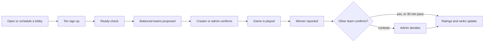

# Keep-Dreaming-Bot

A Discord bot for a private group of friends. It started as a "name of the day" joke and is now a
**League of Legends in-house league manager**: sign-ups and scheduled lobbies, ready-checks, balanced
teams that respect everyone's roles, result reporting, and a hidden rating with a visible in-house
rank that moves as games are played.


> The bot talks to players in Portuguese. This README and the documentation are in English.

## Contents

- [Features](#features)
- [How it works](#how-it-works)
- [Commands](#commands)
- [Testing the commands](#testing-the-commands)
- [The group's roster](#the-groups-roster)
- [Getting started](#getting-started)
- [Configuration](#configuration)
- [Development](#development)
- [Documentation](#documentation)
- [Roadmap](#roadmap)
- [Riot Games disclaimer](#riot-games-disclaimer)

## Features

- **In-house lobbies.** One live message with buttons; ten players start a ready-check, silent
  players are replaced from the reserves. Lobbies can be opened now or scheduled for later, with a
  reminder before the start. State survives restarts.
- **Balanced teams without role picking.** Players never choose a role per game. Each is placed from
  their profile (best role, or next best when roles collide), and similar-strength players meet in the
  same lane.
- **Results and corrections.** A player reports the winner, someone on the other team confirms (or
  it confirms itself after 30 minutes). Admins can void or fix any game, with an audit trail.
- **Ratings and ranks.** Each player has a hidden in-house rating seeded from their League rank and
  changed only by confirmed results. The visible in-house rank (Bot Máximo to KD esports) appears
  after five games.
- **Champion and KDA per game.** Players enter their own stats, an admin validates them; champion
  and role icons show up in lobbies, matches, profiles and Riot history.
- **History, stats and leaderboards.** `/history`, `/stats` and `/leaderboard` read the confirmed
  games: results, per-role and per-champion records, KDA, and boards by tier, win rate and KDA.
  Raw ratings are never shown to players.
- **Optional Riot integration.** Link a League account to seed the rating from the Solo/Duo rank, and
  to estimate role experience and show recent ranked games.
- **Test without ten friends.** Mock players and a simulator let you try lobbies, results and ranks
  alone, and tune the matchmaking offline.
- **Name of the day.** `/puta` and `/putaindor`, the original feature, still run.

## How it works



Three ideas to keep in mind:

1. **Your League rank is the starting point, results take over.** A player's starting strength comes
   from their Riot rank (or one an admin or they set). In-house results then move a separate hidden
   rating, while the starting rank keeps matchmaking from drifting too far from reality.
2. **The in-house rank is its own thing.** It is derived from the hidden rating, hidden until a
   player has finished five placement games, and is not a League rank.
3. **Only confirmed results count.** Every change to a result is audited, and ratings can always be
   rebuilt from the stored games.

The details (formulas, parameters, how teams are scored) are in
[docs/matchmaking.md](docs/matchmaking.md).

## Commands

All commands are slash commands, registered only in the configured server. *Reply* says whether the
answer is **public** (everyone in the channel sees it) or **private** (only the person who ran it;
every error message is private). Commands marked *admin* need your Discord user ID in
`ADMIN_USER_IDS`. Parameters in `[brackets]` are optional.

### Players

| Command | Reply | What it does |
|---|---|---|
| `/register <nickname>` | private | Join the in-house roster (2-24 characters, unique). Starts at a default rating until you give a rank. |
| `/profile view [user]` | public | In-house rank (or placement progress `n/5`), League reference rank, linked Riot accounts, role proficiency with icons. |
| `/profile roles <role> <proficiency>` | private | Set how comfortable you are (1-5) on a role, or `Limpar` to clear it. |
| `/profile rank <tier> [division]` | private | Report your League Solo/Duo rank; it seeds your starting rating while you have few games. |
| `/history [user]` | public | The last 10 confirmed games: result, side, role, champion and KDA (validated stats only; pending ones show "stats por validar"). The header has the overall record. |
| `/stats [user]` | public | Overall record, win rate and KDA; per role; top 5 champions and champion x role (validated stats only). Every figure shows its number of games. |
| `/leaderboard [board]` | public | `board` is *Rank do grupo* (default: players past placement, by tier and division with a progress bar toward the next division; inside a division the fuller bar ranks higher; KD esports, the top step, shows a full bar), *Taxa de vitórias* or *KDA* (both need 5 games; KDA counts validated games; equal scores share a position, A-Z). Ratings are never shown as numbers. |

### Lobbies and games

| Command | Reply | What it does |
|---|---|---|
| `/lobby open` | public | Open the server's in-house lobby in this channel (a live message with buttons). |
| `/lobby schedule <when> [note]` | public | Schedule a lobby (Lisbon time, e.g. `21:00`, `21h30`, `amanhã 21:00`, `sexta 21:00`, `15/08 21:00`, `2026-08-15 21:00`). A reminder goes out 30 minutes before. |
| `/lobby list` | public | The open lobby and the scheduled ones. |
| `/lobby show [lobby]` | public | Re-post a lobby message here (the stale copy is removed). |
| `/lobby cancel [lobby]` | private | Cancel a lobby (its creator or an admin). |
| `/match show [match]` | public | A game's status, teams, roles, champions and KDA (⏳ = pending); the footer says who confirmed the result and who validated the KDAs. Default: the latest game. |
| `/match stats <champion> <kills> <deaths> <assists> [match]` | private | Record your own champion (autocomplete) and KDA (0-99) for a confirmed game; default: your latest game without validated stats. Waits for an admin to validate it. |
| `/match void <match> [reason]` | private + channel notice | *Admin.* Cancel a game; undoes its effect on ratings if it was confirmed. |
| `/match fix <match> <winner>` | private + channel notice | *Admin.* Correct a confirmed result or decide a pending or contested one. |
| `/match set <match> <member> [champion] [kills] [deaths] [assists] [role]` | private | *Admin.* Set or correct someone's stats (validated at once) or the role they actually played. |
| `/match validate <match> [member]` | private | *Admin.* Validate the pending stats of a game (of one player, or of everybody). |
| `/match pending` | private | *Admin.* List the stats waiting for validation, oldest game first. |

The lobby message carries the buttons: **Entrar**, **Sair**, **Pronto**, **Recusar**, **Confirmar**
(teams), **Azul ganhou** / **Vermelho ganhou**, **Confirmar resultado**, **Contestar** and
**Cancelar**. Only the buttons that make sense for the current state are shown. When a result is
confirmed, corrected or voided the bot also posts a summary in the channel (winner, promotions,
demotions, finished placements, and a reminder to use `/match stats`).

### Riot accounts (optional, needs `RIOT_API_KEY`)

Without the key every `/riot` command answers that the integration is disabled.

| Command | Reply | What it does |
|---|---|---|
| `/riot link <riot_id> [platform] [player]` | private | Link a Riot account (`Name#TAG`; the platform defaults to `RIOT_DEFAULT_PLATFORM`). The first becomes the main. Shows the consent notice. Only admins may use `player`. |
| `/riot main <riot_id> [player]` | private | Choose which account supplies the rank. |
| `/riot unlink <riot_id> [player]` | private | Remove an account and all data tied to it. |
| `/riot list [player]` | public | List linked accounts (visible to everyone). |
| `/riot refresh [player]` | private | Refresh names, rank and ranked history (10 minute cooldown for players; admins skip it). |
| `/riot history [player] [riot_id]` | public | Last ten ranked Solo/Duo games: result, champion and role (icons), KDA, CS, duration. |

### Admin

All replies are private.

| Command | What it does |
|---|---|
| `/admin player register <member> [display_name]` | Register a server member in advance. An existing player is never modified. |
| `/admin rating inspect <user>` | Show the hidden rating (H), rank estimate (R) and matchmaking estimate (E): the only place raw numbers appear. |
| `/admin rating set <user> <mu> [sigma] [note]` | Adjust a player's hidden rating (mu 0-100, sigma 0.5-25). Placement still applies. |
| `/admin rating rank <user> [tier] [division]` | Override a player's reference rank (leave the tier empty to clear the override). |
| `/admin rating recompute` | Rebuild all ratings from the stored games. |
| `/admin roles set <user> <role> <proficiency>` | Override a role proficiency (`Limpar` clears it). |
| `/sync` | *Bot owner only.* Re-sync the commands (also done on startup). |

### Testing (only with `ENABLE_MOCK_PLAYERS=true`, admin, private replies)

| Command | What it does |
|---|---|
| `/mock create [count] [main_role]` | Create 1-30 fake players, optionally all with the same main role. |
| `/mock fill [count] [lobby]` | Put fake players into the open (or a given scheduled) lobby; default 9, so you plus 9 make ten. |
| `/mock ready [lobby]`, `/mock drop [lobby]` | Make the fake players confirm the ready-check, or leave. |
| `/mock report <winner> [lobby]`, `/mock confirm [lobby]` | A fake player reports a result, or one on the other team confirms it. |
| `/mock stats [match] [validate]` | The fake players of a confirmed game enter random champion and KDA (optionally validated). |
| `/mock list`, `/mock clear` | List the fake players; delete them and the test games they played. |

Mock players have fake Discord IDs, so they cannot be picked as the `user` of `/profile view`,
`/history` or `/stats`; they only appear in lobbies, games and `/mock list`. They are never listed
on `/leaderboard`.

### Name of the day

| Command | Reply | What it does |
|---|---|---|
| `/puta` | public | Today's name (Europe/Lisbon date); picked at random on first use of the day. |
| `/putaindor` | public | Podium of the three most-picked names. |

A daily task also makes the pick at 00:00 Europe/Lisbon.

## Testing the commands

Two ways to get data to test with.

**1. The real roster with test games (every embed with the real group).** Seed the roster and play
the games, then start the bot on that database (see [The group's roster](#the-groups-roster)):

```bash
python -m bot.features.roster seed
python -m bot.features.roster games
python -m bot
```

You get the 18 real players with their ranks, roles and Riot accounts, and games in every state:
confirmed by players, by an admin and automatically, corrected, voided before and after the result,
contested, reported and in progress. Stats are validated, pending or missing; one of your games has a
played role that differs from the assigned one; two players are still in placement. The reported game
is auto-confirmed about 20 minutes after it is played, so look at it first. A database cannot hold the
*lobby message* of an open or scheduled lobby: use `/lobby open`, `/lobby schedule` and `/mock` for
those. Games in progress block their players from joining a lobby: finish or `/match void` them first.
When you are done, `python -m bot.features.roster reset --keep-roster --yes` removes the games (and
`reset --yes` followed by `seed` rebuilds the roster from scratch).

**2. Mock players on your database** (see [docs/testing-lobbies.md](docs/testing-lobbies.md)):
`ENABLE_MOCK_PLAYERS=true`, `/register`, `/lobby open`, `/mock fill`, `/mock ready`, **Pronto**,
**Confirmar**, `/mock report`, and so on. `/mock clear` removes them and their games afterwards.

**Checklist: what each command should answer.** Texts are in Portuguese, as the bot shows them.

| Try | Expect |
|---|---|
| `/register Ana` | Private: "Registado como **Ana**! Define as tuas roles com /profile roles e o teu rank com /profile rank." A second `/register`, or a nickname already taken: a private error. |
| `/profile roles role:Mid proficiency:5` | Private: "Proficiência em **Mid** definida para 5/5." (`Limpar`: "limpa"). |
| `/profile rank tier:Gold division:II` | Private: "Rank de referência: **Gold II**. Serve só como ponto de partida; ..." |
| `/profile view` | Public embed: *Rank do grupo* (tier, division and a progress bar toward the next division, full on the top step; or "Sem rank (colocação n/5)"), *Rank League (referência)*, Riot accounts if any, *Roles* with icons; the footer says the rank is internal and carries the Riot notice. |
| `/lobby open` | Public lobby message "In-house #n · Aberta" with buttons. A second open: a private error. |
| `/mock fill`, `/mock ready`, then **Pronto** | Ready-check ping, then balanced teams (Azul/Vermelho) with a role icon per player and no ratings shown. |
| **Confirmar**, then `/mock report winner:Azul` | "Resultado por confirmar"; **Confirmar resultado** / **Contestar** appear for the other team. As an admin your confirm is final at once; otherwise use `/mock confirm`. |
| After the result | Public summary: "🏆 In-house #n: **Azul ganhou**", 🎯 finished placement / 📈 / 📉 lines, "Em colocação: ..." and the `/match stats` hint. |
| `/match stats champion:Ahri kills:8 deaths:2 assists:11` | Private: "Jogo #n: **Ahri 8/2/11** registado. Falta um admin validar." |
| `/match show` | Public embed: teams with `<role icon> Name — <champion icon> 8/2/11`, ⏳ while pending, footer "Resultado confirmado por X · KDAs validados por Y · N por validar". |
| `/match pending`, then `/match validate match:n` | Private list "Stats por validar"; then "Jogo #n: k stats validadas." |
| `/match set match:n member:@x champion:Zed kills:1 deaths:2 assists:3 role:Top` | Private confirmation; the stats are validated at once and the played role shows. |
| `/match fix match:n winner:Vermelho`, `/match void match:n reason:teste` | Private "Feito." plus a channel summary ("✏️ Resultado ... corrigido" / "🚫 In-house #n anulada (teste)"); ratings follow. |
| `/history`, `/stats`, `/leaderboard board:...` | The public embeds described in the Players table. A brand-new player: "Ainda não há jogos confirmados."; boards without enough games: "Ainda ninguém tem 5 jogos." / "Ainda ninguém terminou a colocação." |
| `/lobby schedule when:amanhã 21:00 note:teste`, `/lobby list`, `/lobby cancel` | Public "Agendada" message; the list shows both lobbies; cancel answers privately "Lobby cancelada." |
| `/riot link riot_id:Nome#TAG` (needs the key) | Private summary plus the consent notice; `/riot list` and `/riot history` answer publicly. |
| `/admin rating inspect user:@x` | Private embed with H, R and E (raw numbers; the only place they appear). |
| `/admin rating set`, `/admin rating rank`, `/admin roles set`, `/admin rating recompute` | Private one-line confirmations; "Ratings reconstruídos." for recompute. |
| `/sync` | Private: "Sincronizados n comandos." (bot owner only; anyone else is refused). |
| A non-admin running an admin command | Private: "Não tens permissão para usar este comando." An unexpected failure: "Ocorreu um erro inesperado. Tenta novamente mais tarde." |
| `/puta`, `/putaindor` | Public name-of-the-day embeds ("Ainda não há ranking; usa /puta para começar." before any pick). |

## The group's roster

The group's database starts from a roster file, so everyone is registered, ranked and linked before
the bot goes live. The tool is `python -m bot.features.roster` (stop the bot first; every command that
writes makes a backup copy next to the database, `*.sqlite3.bak-<time>-<reason>`).

1. **Fill the file.** Copy `tools/roster.example.json` to `data/roster.json` (git-ignored: it holds real
   Discord ids and Riot names) and fill one entry per player: `discord_id`, `nickname` (2-24
   characters, unique), `rank` (tier and division, or `null`), `roles` (role to proficiency 1-5),
   `riot` (a list of `Name#TAG`, the first is the main account), `platform` and, optionally,
   `strength`. The file explains each field at the top.
2. **Check it.** `python -m bot.features.roster check` reads the file, lists every problem at once
   (wrong tier, duplicate id, bad Riot ID...) and shows each player with the strength a simulation
   would use. It changes nothing.
3. **Seed the database.** `python -m bot.features.roster seed` registers everyone through the same
   services as `/register`, `/profile rank` and `/profile roles`, and links the Riot accounts through
   the real `/riot link` process (needs `RIOT_API_KEY`; with `--no-riot` they are skipped). It can be
   run again: players already there are kept, only a changed rank or role is applied, and accounts
   already linked are skipped. The `/puta` names, phrases and history are never touched.
   It prints each player as it goes and finishes in a couple of minutes. The ranked-history download
   (up to 100 games per account, about one request every two seconds on a personal key) is *not*
   done here: the bot continues it in the background when it starts. `--wait-history` does it now
   (expect an hour). Press Ctrl+C at any time; running `seed` again continues. The first line of every
   command shows which database it uses and where that came from. If it says `DB_PATH environment
   variable` and you did not mean it, clear it (`Remove-Item Env:DB_PATH` in PowerShell).
4. **Play test games with the real players** (optional, for reviewing the bot's messages):
   `python -m bot.features.roster games` plays 22 finished games through the real lobby, balancer and
   rating services, plus a contested, a reported and an in-progress game. Who wins follows each
   player's hidden `strength` (the file's value, or one derived from the rank), so you can tweak it
   for people you know are over- or under-ranked. Two newcomers stay in placement. The three
   unfinished games are completed with mock players (`Mock Extra NN`), because nobody can be in two
   games at once. Options: `--games`, `--newcomers`, `--seed`, `--guild-id`.
5. **Judge the matchmaking.** `python -m bot.features.roster matches` lists every game in order,
   lane by lane: blue against red, each player's matchmaking estimate (E, in rating points), the gap per
   lane, the balancer's expected win chance, the winner, and whether the favourite or the underdog
   won. It ends with a summary (how many games were near even, how often the favourite won, the
   average lane gap, the most lopsided game). `--match 12` shows one game, `--finished` skips
   voided and unfinished ones. It only reads the file, so it is safe while the bot runs. In Discord,
   `/match show match:12` posts one game's teams, but never the numbers.
6. **Go back to a clean database.** `python -m bot.features.roster reset` shows what would be removed
   and changes nothing; with `--yes` it deletes **all league data**: players, roles, ranks, Riot
   accounts and their stored games, ratings, lobbies, games and mock players. Run `seed` afterwards
   to put the roster back. The `/puta` names, phrases and picks, the champion list and the uploaded
   icon ids always stay. `reset --keep-roster --yes` is the lighter version: it removes only the test
   games, lobbies, rating adjustments and mock players and keeps the roster (use it to replay `games`).

   To prepare production: `reset --yes`, then `seed`, and do not run `games`. The database then holds
   the fresh roster and the `/puta` data, nothing else.

The roster's own rows are dated just before the first test game (so the history can sit in the past);
`games` refuses to run on a database that already has games, run `reset --keep-roster --yes` first. To pick a
player in `/profile view`, `/history` or `/stats`, that person must be a member of the server you
test in; everyone else still shows up in `/leaderboard`, `/match show` and the games.

## Getting started

**Requirements:** Python 3.11 or newer, and a Discord application with a bot user.

1. **Create the bot.** In the [Discord Developer Portal](https://discord.com/developers/applications),
   create an application, add a bot, and copy its token (*Bot -> Reset Token*). Invite it to your
   server with the scopes `bot` and `applications.commands`. No privileged intents are needed.
2. **Install.**

   ```bash
   git clone https://github.com/PM-Delgado/Keep-Dreaming-Bot.git
   cd Keep-Dreaming-Bot
   python -m venv .venv
   source .venv/bin/activate        # Windows: .venv\Scripts\activate
   pip install -e ".[dev]"
   ```

3. **Configure.** Copy `.env.example` to `.env` and fill in at least `DISCORD_TOKEN`, `GUILD_ID` and
   `ASSETS_URL`. Never commit `.env`.
4. **Run.**

   ```bash
   python -m bot
   ```

   On startup the bot creates the SQLite database, applies pending migrations and syncs the
   commands to your server.

To try the lobby alone, set `ENABLE_MOCK_PLAYERS=true` and `ADMIN_USER_IDS` to your own user ID, then
follow [docs/testing-lobbies.md](docs/testing-lobbies.md). To review every embed with the real group,
seed the roster and play test games; both ways are described in [Testing the commands](#testing-the-commands).

## Configuration

Read once at startup from the environment or `.env` (`bot/config.py`).

| Variable | Required | Default | Purpose |
|---|---|---|---|
| `DISCORD_TOKEN` | yes | | Bot token. |
| `GUILD_ID` | yes | | The server the commands are registered in. |
| `ASSETS_URL` | yes | | Base URL of the images used by the name-of-the-day embeds. |
| `ADMIN_USER_IDS` | no | none | Comma-separated Discord user IDs allowed to run admin commands. Empty means nobody. |
| `DB_PATH` | no | `data/kdbot.sqlite3` | SQLite file location. |
| `RIOT_API_KEY` | no | | Enables the `/riot` commands. Without it ranks and roles are set manually. |
| `RIOT_DEFAULT_PLATFORM` | no | `euw1` | Platform used when `/riot link` does not specify one. |
| `READY_CHECK_SECONDS` | no | `120` | Ready-check length. |
| `CHAMPION_ICONS` | no | on | Show champion and role icons (Riot images, uploaded once as bot emojis) in lobbies, `/match show`, `/profile` and `/riot history`; names are used where an icon is missing. `false` turns them off; see `docs/riot-policy.md`. |
| `ENABLE_MOCK_PLAYERS` | no | off | Enables the `/mock` commands. Leave off in production. |

**Data.** Everything is in one SQLite file (plus `-wal` and `-shm` files while the bot runs). Back it
up by copying the `data/` folder while the bot is stopped. Schema changes are versioned migrations
in `bot/db.py` and are applied automatically; an applied migration is never edited.

## Development

```bash
ruff check . && ruff format --check .   # lint and formatting
pyright                                 # types
pytest                                  # tests; add -m "not slow" to skip the long simulations
```

Tests need no token and no network.

**Layout**

```
bot/
  __main__.py, app.py, config.py, db.py   entry point, bot, settings, SQLite + migrations
  features/
    nameday/       the original name-of-the-day feature
    admin/         /sync
    players/       roster, role proficiency, profile, admin rating and role commands
    riot/          optional Riot API client, role experience, /riot commands
    champions/     champion list from Data Dragon (cached, with a bundled seed) for /match stats
    icons/         role icons (bundled PNGs uploaded as application emojis), shared upload helper
    ratings/       pure rating core: rank estimate, matchmaking estimate, ladder, OpenSkill, replay
    balance/       pure team balancer
    lobby/         lobby state machine, messages, buttons, /lobby /match /mock commands
    matches/       match records: results, confirmations, corrections, audit
    stats/         read-only /history, /stats and /leaderboard from confirmed games
    simulation/    scenarios, simulated seasons and the tuning lab (not loaded by the bot)
    roster/        roster file, seeding, test games with the real players, reset (not loaded by the bot)
tests/             pytest, in-memory SQLite
tools/             dev-only scripts (ladder_sim.py) and the roster file template
docs/              internal documentation
```

Each feature keeps Discord out of its rules: `service.py` holds the logic, `repository.py` the SQL,
`cog.py` the slash commands. A new feature goes in `bot/features/<name>/` and its `cog` module is
added to `EXTENSIONS` in `bot/app.py`.

**Simulate the matchmaking** (no Discord needed):

```bash
python -m bot.features.simulation scenario all                 # how the balancer lands fixed lobbies
python -m bot.features.simulation season --players 14 --games 40   # a whole simulated season
python -m bot.features.simulation tune baseline                # the tuning lab
```

## Documentation

The internal documentation lives in [`docs/`](docs/README.md):

- [Status and hand-off](docs/status.md): what is done, what is left, agreed designs.
- [Ratings, ranks and matchmaking](docs/matchmaking.md): how it all works in detail.
- [Simulations](docs/simulations.md): how to test and tune without Discord.
- [Tuning](docs/tuning.md): how the settings were chosen, with results.
- [UI pass guide](docs/ui-pass-guide.md) (every command, step by step, with a worksheet), [Testing lobbies by hand](docs/testing-lobbies.md) (and the [command checklist](#testing-the-commands) above) and [Riot policy notes](docs/riot-policy.md).

## Roadmap

- [x] Roster, role proficiency, hidden rating and visible in-house rank
- [x] Optional Riot account linking, rank and ranked history
- [x] Lobbies, ready-check, scheduled lobbies and role-aware balanced teams
- [x] Result reporting, confirmation, corrections, ratings from games
- [x] Simulator and tuning lab
- [x] Champion and KDA entry with admin validation, champion and role icons
- [x] Match history, personal stats and leaderboards
- [ ] Optional captain draft

## Riot Games disclaimer

Keep-Dreaming-Bot isn't endorsed by Riot Games and doesn't reflect the views or opinions of Riot
Games or anyone officially involved in producing or managing Riot Games properties. Riot Games, and
all associated properties are trademarks or registered trademarks of Riot Games, Inc. The in-house
ranks are internal to the group and are not League of Legends ranks. See
[docs/riot-policy.md](docs/riot-policy.md) for how Riot data is used.

## License

No license has been chosen yet, so by default all rights are reserved. Add a `LICENSE` file before
accepting contributions.
