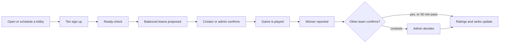

<p align="center">
  
  
</p>

<p align="center">
  <b>The Discord bot of the Keep Dreaming community.</b><br>
  The name of the day, League of Legends scrims with balanced teams and ratings, and whatever the server asks for next.
</p>

<p align="center">
  <a href="https://github.com/PM-Delgado/Keep-Dreaming-Bot/actions/workflows/ci.yml"></a>
  
  
  
  
  
  <a href="https://railway.com"></a>
</p>

<p align="center">
  <a href="#-what-it-does-today">What it does</a> ·
  <a href="#-how-scrims-work">How Scrims work</a> ·
  <a href="#-run-your-own-copy">Run your own copy</a> ·
  <a href="#-commands">Commands</a> ·
  <a href="#-configuration">Configuration</a> ·
  <a href="docs/README.md">Docs</a>
</p>

## 📖 What it is

Keep-Dreaming-Bot is the bot of the **Keep Dreaming** Discord server. It is made for that community and
runs there every day. It is not a public bot (there is no invite link) and it is not meant to be a
general-purpose matchmaking product: it is the server's own bot, and it does whatever the community has
wanted so far. It runs 24/7 on [Railway](https://railway.com) as a single worker service, deployed
straight from the `main` branch of this repository (a merge that changes the bot's code or dependencies
redeploys it), with its SQLite database on a persistent volume.

It started as a "name of the day" joke and has grown one feature at a time. It currently does two things,
and gets more as the server asks for them:

- **Name of the day**, the original joke.
- **Scrims**, the server's League of Legends in-house games: lobbies, balanced teams, results, ratings
  and stats.

The code is open so anyone can read it, learn from it or fork it. Running your own copy is possible (see
[below](#-run-your-own-copy)) but it is not the goal, and the server's choices are built in: **the bot's
replies are in Portuguese**, and the Scrims ranks and names are the community's own. This README, the code
and the docs are in English.

## ✨ What it does today

### 🎮 Scrims

- **In-house lobbies.** One live message with buttons. Ten players start a ready-check and silent players
  are replaced from the reserves. Open a lobby now or schedule it, with a reminder before the start. State
  survives restarts.
- **Balanced teams without role picking.** Each player is placed from their profile (best role, or next
  best when roles collide), and players of similar strength meet in the same lane.
- **Results and corrections.** One player reports the winner, someone on the other team confirms (or it
  confirms itself after 30 minutes). Admins can void or fix any game, with an audit trail.
- **Ratings and ranks.** A hidden in-house rating starts from the player's League rank and changes only
  with confirmed results. The visible in-house rank appears after five games.
- **Champion and KDA per game.** Players enter their own stats and an admin validates them; champion and
  role icons show up in lobbies, matches and profiles.
- **History, stats and leaderboards.** `/history`, `/stats` and `/leaderboard` read the confirmed games.
  Raw ratings are never shown to players.
- **Optional Riot integration.** Link a League account to seed the rating from the Solo/Duo rank, estimate
  role experience and show recent ranked games.

### 📅 Name of the day

`/goomah` shows today's name, picked at random the first time it is used each day (Europe/Lisbon date; a
daily task also picks at midnight), and `/goomahdor` shows the three most-picked names.

## 🧩 How Scrims work



1. **Your League rank is the starting point, results take over.** A player's starting strength comes from
   their Riot rank (or one they or an admin set). In-house results then move a separate hidden rating,
   while the starting rank keeps matchmaking from drifting too far from reality.
2. **The in-house rank is its own thing.** It is derived from the hidden rating, hidden until a player has
   finished five placement games, and is not a League rank.
3. **Only confirmed results count.** Every change to a result is audited, and ratings can always be
   rebuilt from the stored games.

The formulas, parameters and how teams are scored are in [docs/matchmaking.md](docs/matchmaking.md).

## 🚀 Run your own copy

You do not need this to use the bot on the Keep Dreaming server. It is for developing the bot or running a
fork of it with your own Discord application.

**Requirements:** Python 3.11 or newer and a Discord application with a bot user.

1. **Create the bot.** In the [Discord Developer Portal](https://discord.com/developers/applications),
   create an application, add a bot and copy its token (*Bot -> Reset Token*). Invite it to your server
   with the scopes `bot` and `applications.commands`. No privileged intents are needed.
2. **Install.**

   ```bash
   git clone https://github.com/PM-Delgado/Keep-Dreaming-Bot.git
   cd Keep-Dreaming-Bot
   python -m venv .venv
   source .venv/bin/activate        # Windows: .venv\Scripts\activate
   pip install -e ".[dev]"
   ```

3. **Configure.** Copy `.env.example` to `.env` and fill in at least `DISCORD_TOKEN` and `GUILD_ID`.
   Never commit `.env`.
4. **Run.**

   ```bash
   python -m bot
   ```

On start-up the bot creates the SQLite database, applies pending migrations and syncs the commands to
your server. To try a lobby alone, set `ENABLE_MOCK_PLAYERS=true` and `ADMIN_USER_IDS` to your own user ID,
then follow [docs/testing.md](docs/testing.md). To keep it running, see [docs/self-hosting.md](docs/self-hosting.md).

## 💬 Commands

All commands are slash commands, registered only in the configured server. Commands marked *admin* need
your Discord user ID in `ADMIN_USER_IDS`. Every command, with who can run it, whether the reply is public
or private and what it answers, is in [docs/commands.md](docs/commands.md).

| Area | Commands |
|---|---|
| **Players** | `/register`, `/profile view\|roles\|rank`, `/history`, `/stats`, `/leaderboard` |
| **Lobbies and games** | `/lobby open\|schedule\|list\|show\|cancel`, `/match show\|stats`; *admin:* `/match void\|fix\|set\|validate\|pending` |
| **Riot accounts** (optional) | `/riot link\|main\|unlink\|list\|history\|refresh` |
| **Admin** | `/admin player register`, `/admin rating inspect\|set\|rank\|recompute`, `/admin roles set`, `/sync` |
| **Testing** (`ENABLE_MOCK_PLAYERS`) | `/mock create\|fill\|ready\|drop\|report\|confirm\|stats\|list\|clear` |
| **Name of the day** | `/goomah`, `/goomahdor` |

## 🔧 Configuration

Read once at start-up from the environment or `.env` (`bot/config.py`; see `.env.example`).

| Variable | Required | Default | Purpose |
|---|---|---|---|
| `DISCORD_TOKEN` | yes | | Bot token. |
| `GUILD_ID` | yes | | The server the commands are registered in. |
| `ADMIN_USER_IDS` | no | none | Comma-separated Discord user IDs allowed to run admin commands. Empty means nobody. |
| `DB_PATH` | no | `data/kdbot.sqlite3` | SQLite file location. |
| `RIOT_API_KEY` | no | | Enables the `/riot` commands. Without it ranks and roles are set manually. |
| `RIOT_DEFAULT_PLATFORM` | no | `euw1` | Platform used when `/riot link` does not specify one. |
| `READY_CHECK_SECONDS` | no | `120` | Ready-check length. |
| `CHAMPION_ICONS` | no | on | Show champion, role and rank icons (Riot images, uploaded once as bot emojis); names are used where an icon is missing. See [docs/riot-data.md](docs/riot-data.md). |
| `SCRIM_CHANNEL_ID` | no | any channel | The only channel where `/lobby open`, `/lobby schedule` and `/lobby show` work. |
| `RIOT_FEED_CHANNEL_ID` | no | off | The channel where the bot posts the daily Solo/Duo leaderboard (10:00 Lisbon) and a card after every ranked game of the linked accounts. Needs `RIOT_API_KEY`. |
| `SCRIM_ROLE_ID` | no | no tag | The role tagged (inside a spoiler) when a lobby is opened or scheduled. It must be mentionable, or the bot needs the "Mention @everyone, @here and All Roles" permission; the start-up log says if it is not. |
| `ENABLE_MOCK_PLAYERS` | no | off | Enables the `/mock` commands. Leave off in production. |
| `LOG_LEVEL` | no | `INFO` | `DEBUG`, `INFO`, `WARNING` or `ERROR`. |
| `LOG_DIR` | no | `logs` | Folder of the daily rotating log file (14 days kept). Empty: console only. See [docs/logging.md](docs/logging.md). |

Everything is stored in one SQLite file. Back it up while the bot is stopped (or see
[docs/self-hosting.md](docs/self-hosting.md#backups)). Schema changes are versioned migrations in `bot/db.py`,
applied automatically; an applied migration is never edited.

## 💻 Development

```bash
ruff check . && ruff format --check .   # lint and formatting
pyright                                 # types
pytest                                  # tests; add -m "not slow" to skip the long simulations
```

Tests need no token and no network. Mock players and an offline simulator let you try Scrims without ten
people: see [docs/testing.md](docs/testing.md) and [docs/simulations.md](docs/simulations.md). Issues and pull
requests are welcome; please read [CONTRIBUTING.md](CONTRIBUTING.md) first.

```
bot/
  __main__.py, app.py, config.py, db.py   entry point, bot, settings, SQLite + migrations
  features/
    nameday/       the original name-of-the-day feature
    players/       roster, role proficiency, profile, admin rating and role commands
    riot/          optional Riot API client, role experience, /riot commands
    champions/     champion list from Data Dragon (cached, with a bundled seed)
    icons/         role and rank icons (bundled PNGs uploaded as application emojis), shared upload helper
    ratings/       pure rating core: rank estimate, matchmaking estimate, ladder, OpenSkill, replay
    balance/       pure team balancer
    lobby/         lobby state machine, messages, buttons, /lobby /match /mock commands
    matches/       match records: results, confirmations, corrections, audit
    stats/         read-only /history, /stats and /leaderboard from confirmed games
    simulation/    scenarios, simulated seasons and the tuning lab (not loaded by the bot)
    roster/        roster file, seeding, test games, reset (not loaded by the bot)
tests/             pytest, in-memory SQLite
tools/             dev-only scripts and the roster file template
docs/              documentation
```

Each feature keeps Discord out of its rules: `service.py` holds the logic, `repository.py` the SQL,
`cog.py` the slash commands. A new feature goes in `bot/features/<name>/` and its `cog` module is added to
`EXTENSIONS` in `bot/app.py`. Try the matchmaking without Discord:

```bash
python -m bot.features.simulation scenario all                     # how the balancer lands fixed lobbies
python -m bot.features.simulation season --players 14 --games 40   # a whole simulated season
```

## 📚 Documentation

Everything else lives in [`docs/`](docs/README.md): the [full command reference](docs/commands.md),
[how ratings and matchmaking work](docs/matchmaking.md), [self-hosting](docs/self-hosting.md),
[logging](docs/logging.md), [testing by hand](docs/testing.md), [simulations](docs/simulations.md),
the [roster tool](docs/roster-tool.md) and the [Riot data notes](docs/riot-data.md).

## 🧭 Roadmap

Scrims, so far. Other features are added as the Keep Dreaming community asks for them.

- [x] Roster, role proficiency, hidden rating and visible in-house rank
- [x] Optional Riot account linking, rank and ranked history
- [x] Lobbies, ready-check, scheduled lobbies and role-aware balanced teams
- [x] Result reporting, confirmation, corrections, ratings from games
- [x] Simulator and tuning lab
- [x] Champion and KDA entry with admin validation, champion and role icons
- [x] Match history, personal stats and leaderboards
- [ ] Optional captain draft

## 🙏 Acknowledgements

Built with [discord.py](https://github.com/Rapptz/discord.py) and [OpenSkill](https://github.com/OpenDebates/openskill.py)
for the team ratings. Champion data and icons come from Riot's Data Dragon, and the role and rank icons from
[Community Dragon](https://www.communitydragon.org).

## 📜 Riot Games disclaimer

Keep-Dreaming-Bot isn't endorsed by Riot Games and doesn't reflect the views or opinions of Riot Games or
anyone officially involved in producing or managing Riot Games properties. Riot Games, and all associated
properties are trademarks or registered trademarks of Riot Games, Inc. The in-house ranks are internal to
the group and are not League of Legends ranks. See [docs/riot-data.md](docs/riot-data.md) for how Riot data
is used.

## 📝 License

Released under the [MIT License](LICENSE).
